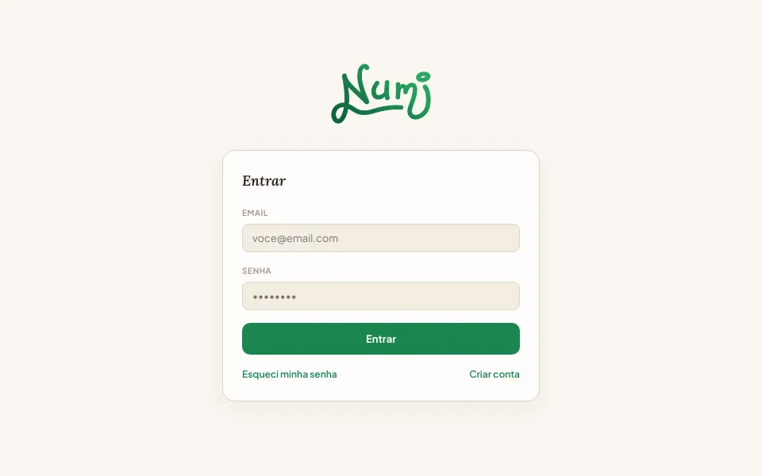
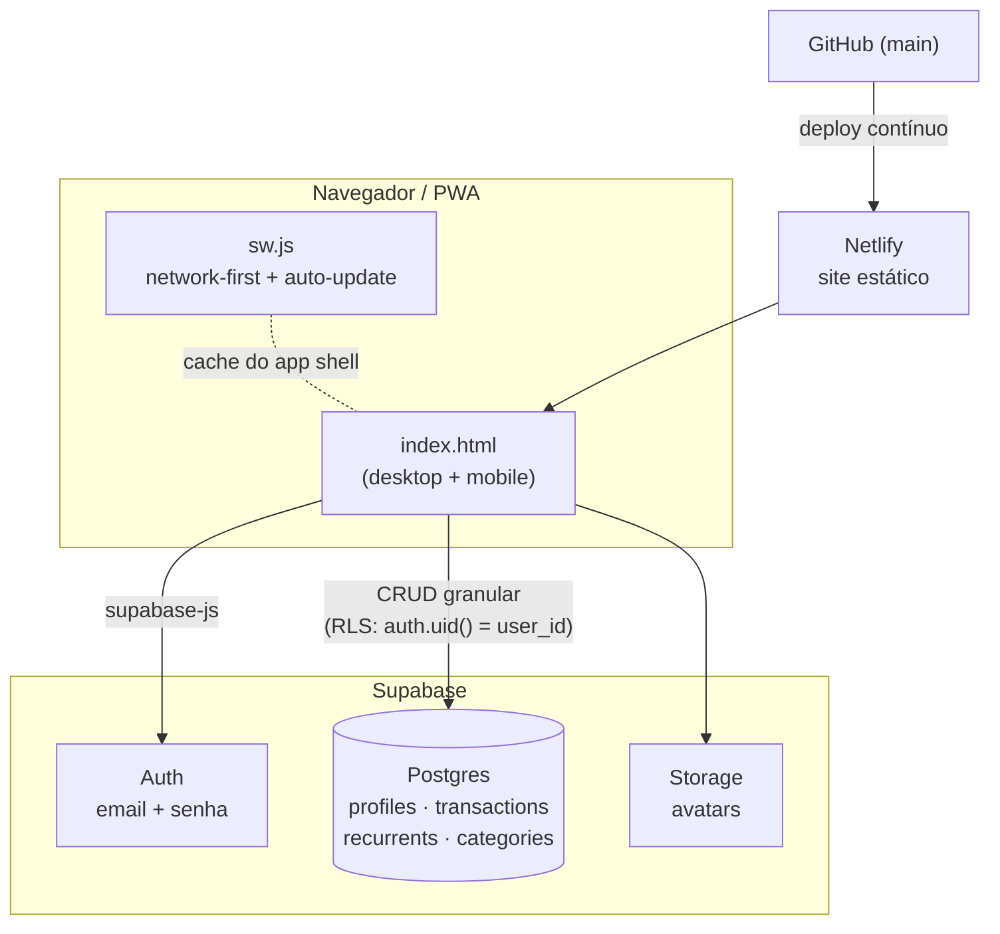

<div align="center">


### Controle financeiro pessoal, multiusuário, instalável no celular

**[numi-finance.netlify.app](https://numi-finance.netlify.app)**


</div>

---

O **Numi** nasceu como uma planilha virando app: um único `index.html` que eu usava para
controlar meus próprios gastos. Ele evoluiu para um produto multiusuário de verdade, com
login, banco relacional com isolamento por usuário, onboarding, importação de planilhas e
PWA instalado no Android, construído em ciclos curtos de especificação → implementação
por agente de IA → validação.

<p align="center">
  
</p>

## Funcionalidades

- **Dashboard** com saldo, taxa de poupança, gastos por categoria (donut) e evolução mensal (linha)
- **Receitas, despesas e recorrentes**: criar, editar e excluir, com categorias e meio de pagamento
- **Meta de economia** com cálculo automático da meta mensal a partir da data de início do usuário
- **Detalhe por mês**: receitas × despesas, gastos por categoria e top 5 maiores despesas
- **Onboarding guiado**: perfil com foto, ponto de partida, meta e importação de dados anteriores
- **Importar/exportar `.xlsx`**: modelo baixável, validação linha a linha e preview de erros antes de gravar
- **Duas interfaces no mesmo app**: desktop (sidebar) e mobile (bottom nav + bottom sheets)
- **PWA** com splash screen, ícones próprios e atualização automática ("nova versão disponível")

## Arquitetura



**Decisões que valem destacar**

- **Do "último que salva ganha" para escrita granular.** A primeira versão guardava todo o
  estado num único JSON e sobrescrevia tudo a cada alteração. Com dois dispositivos abertos,
  lançamentos se perdiam. A versão atual usa tabelas relacionais e `insert`/`update`/`delete`
  por linha, recarregando do banco quando o app volta ao primeiro plano.
- **Segurança no banco, não no cliente.** A chave usada no front-end é a `anon` (pública por
  design). O isolamento entre usuários é garantido por **Row Level Security** em todas as
  tabelas e no bucket de avatares. Veja [`supabase/01_schema.sql`](supabase/01_schema.sql).
- **Migração sem perda.** Os dados da versão antiga foram migrados por script
  ([`supabase/02_migracao.js`](supabase/02_migracao.js)) com relatório de validação
  (contagens e somas) conferido antes de desligar o modelo antigo.
- **Sem build step.** HTML/CSS/JS puros, bibliotecas via CDN (Chart.js, supabase-js, SheetJS).
  Deploy é estático e o app abre rápido mesmo em rede móvel.
- **Cache que não prende versão antiga.** O service worker é network-first para o HTML e
  usa `skipWaiting` + `clients.claim`, depois de um problema real de PWA preso em versão antiga
  no Android.

## Desenvolvimento com agentes de IA

O app foi construído com o **Claude Code** como par de programação. Eu atuei como
product owner e revisor técnico: escrevi especificações com contexto, restrições, ordem
de entrega e critérios de aceite, e o agente implementou em etapas com pontos de parada
para validação.

As especificações originais estão em [`docs/ai-workflow/`](docs/ai-workflow/), com uma
explicação do processo e do que funcionou.

## Estrutura

```
controle-financeiro-deploy/   app publicado (index.html, sw.js, manifest, ícones, assets)
supabase/                     schema + RLS + storage, e script de migração
docs/
  ai-workflow/                specs usadas para conduzir o agente de IA
  DEPLOY.md                   checklist de deploy e testes manuais
netlify.toml                  configuração de publicação
```

## Rodando localmente

O Supabase Auth não funciona via `file://`, então sirva por HTTP:

```bash
npx serve -l 3000 controle-financeiro-deploy
```

**Modo de teste sem banco:** `dev/build-mock.sh` gera uma cópia do app que usa um Supabase
falso em memória ([`dev/mock-supabase.js`](dev/mock-supabase.js)) com dados fictícios, já
logado. Serve para validar mudanças de interface sem conta e sem tocar em dados reais:

```bash
sh dev/build-mock.sh && python -m http.server 8790 --directory dev/.site
```

Abra `http://localhost:3000`. Para usar um projeto Supabase próprio, rode
`supabase/01_schema.sql` no SQL Editor e troque `SUPABASE_URL` / `SUPABASE_ANON_KEY` no
topo do script em `index.html`.

## Roadmap

- [ ] Categorização automática de transações com LLM (Supabase Edge Function, saída estruturada e validada)
- [ ] Perguntas em linguagem natural sobre os próprios gastos
- [ ] Resumo mensal com insights gerados por IA
- [ ] Seletor de ano (os dados já são armazenados com `year`)

## Autor

**Gabriel Castro** · [GitHub](https://github.com/gabrielcastro08)

Licenciado sob a [MIT License](LICENSE).
